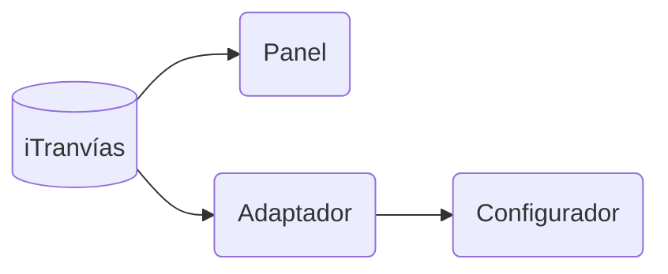

# API Server

El panel consulta iTranvías directamente, en `https://itranvias.com/queryitr_v3.php`. No mantiene un WebSocket abierto contra ningún servidor.

La web pública del mapa es [https://configurador-coru.vercel.app](https://configurador-coru.vercel.app). Publica las mismas rutas REST (`/feeds`, `/stops/within`, `/stops/{id}/routes`, `/schedule/...`) para poder elegir parada y línea. En cuanto esa elección queda grabada, el panel no vuelve a llamarla: las llegadas las pide él a iTranvías. El código está en `api/`.

La descripción de queryitr está en [itranvias_api](https://pedrorey.es/itranvias_api/itranvias_api.html). No hay feeds GTFS, OneBusAway, HAFAS ni ninguna otra ciudad.



iTranvías publica los buses que están en servicio, con los minutos que faltan para llegar a la parada. El firmware convierte eso en el nombre comercial de la línea y un destino. El destino sale del recorrido: la primera ruta de la línea va hacia `nombre_dest`, la segunda hacia `nombre_orig` y la última parada reportada por el bus elige el sentido.

Cuando una línea no tiene buses activos, no hay hora de paso planificada que mostrar. El panel enseña que no hay próximas llegadas.

## Arranque del adaptador

```bash
cd api
python3 -m venv .venv
. .venv/bin/activate
pip install -r requirements.txt
python -m itranvias_adapter
```

También se puede levantar con `docker compose up --build` dentro de `api/`. Escucha en el puerto 8080.

En el configurador, pestaña **Advanced**, la URL del API es `https://configurador-coru.vercel.app`. El único feed es `coruna`. Los identificadores que guarda el panel son del estilo `coruna:100` para la línea 1 y `coruna:1` para la parada Puerta Real. Una selección anterior con otro prefijo de feed no se interpreta: hay que volver a elegir la parada.

El reloj del firmware usa `Europe/Madrid` y el texto por defecto de una llegada inmediata es «Ahora». El firmware de este fork no consulta el manifiesto de actualización de Eastside.
